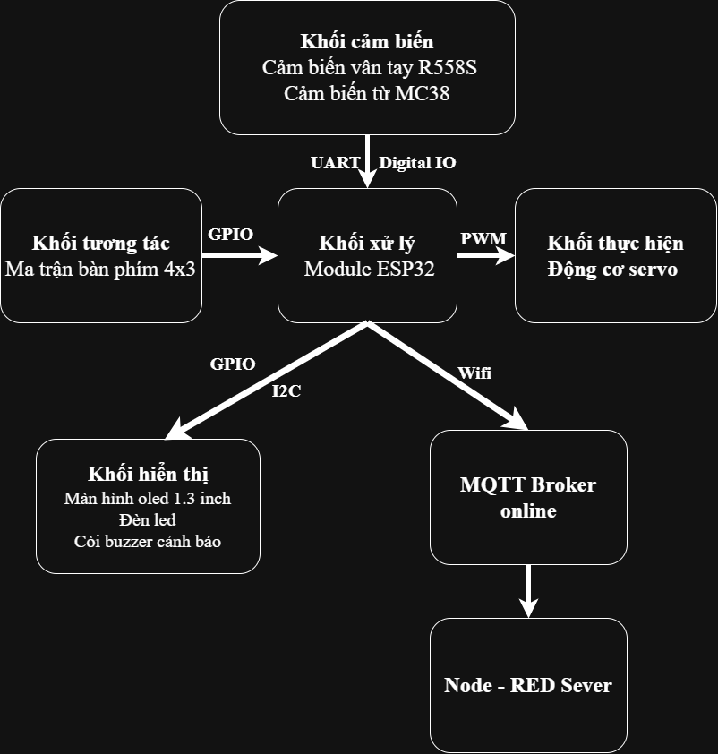

# Hệ thống khóa cửa thông minh xác thực vân tay
| Họ và tên | Mã sinh viên |
| :--- | :---: |
| Trần Trí Tài| `23001625` |
  
  Hệ thống giám sát ra vào tự động sử dụng cảm biến vân tay kết hợp vi điều khiển ESP32. Có thể mở khóa từ xa trên điện thoại và đồng thời có thể thêm và loại bỏ vân tay của các thành viên.

## 1. Tổng quan dự án
- Hệ thống khóa cửa thông minh xác thực vân tay là một giải pháp an ninh kiểm soát ra vào tích hợp công nghệ IoT.
- Hệ thống cho phép người dùng mở cửa bằng vân tay sinh trắc học, quản lý người dùng và mở cửa từ xa thông qua ứng dụng di động hoặc Web Dashboard.
- Mọi dữ liệu ra vào, trạng thái cảnh báo an ninh được đồng bộ theo thời gian thực đồng thời được gửi lên Server Cloud, giúp chủ nhà dễ dàng giám sát an ninh ngôi nhà mọi lúc, mọi nơi.
## 2. Đặt bài toán
Trong cuộc sống hiện đại, các giải pháp quản lý ra vào truyền thống đang bộc lộ nhiều hạn chế lớn:
-  Chìa khóa cơ truyền thống: Dễ bị thất lạc, quên chìa, kẻ gian có thể đánh tráo hoặc sao chép dễ dàng.
-  Khóa điện tử thông thường: Đa số hoạt động độc lập, giá thành đắt đỏ nhưng thiếu khả năng giám sát từ xa.

Dự án được tạo ra nhằm loại bỏ những bất tiện của các loại khóa cơ truyền thống cũng như cải thiện khả năng quản lý của khóa điện tử thông thường. Hệ thống giúp việc ra vào trở nên nhanh chóng, tự động chốt an toàn khi khép cửa và dễ dàng quản lý.
 
## 3. Phần cứng dự kiến.

1. ESP32 CP2102.
2. Cảm biến vân tay điện dung R558S.
3. Cảm biến từ MC38.
4. Ma trận bàn phím 4x3.
5. Còi báo Buzzer.
6. Màn hình OLED 1.3 inch.
7. Động cơ servo SG90.
8. Đèn LED.

## 4. Hình ảnh phần cứng dự kiến.

<table>
  <tr>
    <td align="center">
       
      <b>Cảm biến điện dung R558S</b>
    </td>
    <td align="center">
       
      <b>Màn hình OLED 1.3 inch</b>
    </td>
    <td align="center">
       
      <b>Ma trận bàn phím 3x4</b>
    </td>
  </tr>
  <tr>
    <td align="center">
       
      <b>Động cơ Servo SG90</b>
    </td>
    <td align="center">
       
      <b>Cảm biến từ MC38</b>
    </td>
    <td align="center">
       
      <b>Còi Buzzer</b>
    </td>
  </tr>
</table>

## 5. Sơ đồ khối dự kiến.

<td align="center">
       
 </td>
